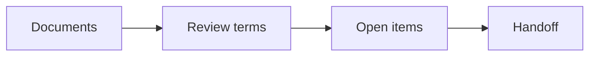

# Updating the portfolio

Use `npm run dev` while editing. Astro refreshes the browser when a file changes. These changes stay on your computer until you deliberately publish a later build.

## Shared details and links

Edit `src/data/site.ts` for your email, availability badge, testimonial, profile destinations, footer date, and preview setting.

Resume points to the supplied Google Drive document. Instagram, TikTok, X, Threads, Medium, Substack, LinkedIn, and the personal blog are also populated in `site.links`. Update their quoted URLs there when a destination changes.

For a local resume, put your PDF in `public/resume.pdf` and set `resume: '/resume.pdf'`. The current contact address is `hello@irfankurnia.com`.

Keep `updated` in `YYYY-MM-DD` format. Change it when the site’s content changes; it is not an automatic deployment timestamp. The copyright year is generated at build time.

## Add or edit a project

Each case study has two Markdown files with the same filename:

- `src/content/projects/finodus.md`: the **full case study** and shared project metadata, at `/work/finodus/`.
- `src/content/projects/tldr/finodus.md`: the **TL;DR version**, at `/work/finodus/tldr/`.

The pair creates one Work card. The toggle below the featured image switches between the two articles and their tables of contents. Full Case Study is the default when visitors open a Work card. Each version has a direct URL that survives reloading and supports browser Back/Forward; the links also work without JavaScript.

To add a project, copy both files and give them the same descriptive filename. Edit the frontmatter in the **full version only**:

```yaml
---
title: Your project title
summary: A short, factual description of the problem and your work.
tags: [Product Design, Research]
role: Your actual contribution
timeline: Your project timeline
date: October 2026
tools: [Figma]
cover: /projects/example/cover.png
order: 5
placeholder: false
---
```

`cover` is optional. Put that file in `public/projects/example/cover.png`; its URL omits the `public` prefix. Use transparent PNGs when the artwork needs transparency. Supply a compressed image at roughly twice its intended display width. A missing `cover` shows an explicitly labelled image placeholder.

To show project buttons below the tags, add an optional `links` list to the full file's frontmatter. Choose one or two entries, in the order you want them displayed:

```yaml
links:
  - type: figma
    url: https://www.figma.com/design/your-file
  - type: repository
    url: https://github.com/your-name/your-project
```

| Type         | Button label       |
| ------------ | ------------------ |
| `figma`      | See Figma File     |
| `repository` | View Repository    |
| `prototype`  | See Live Prototype |

Each type uses its supplied icon automatically. Use an `https://` or `http://` URL; all buttons open in a new tab. Omit `links` until you have destinations ready. Both Full and TL;DR versions share these buttons.

Each Markdown body is its own article. The TL;DR file needs no frontmatter: the title, summary, tags, role, timeline, date, tools, cover, links, and draft status all come from the full version. Write a shorter account of the problem, your contribution, and the outcome there, keeping unverified results clearly marked. The supplied TL;DR copy is a draft for you to revise alongside the full narrative.

Every `## Heading` automatically appears in that version’s table of contents. Use sections that fit the actual story; the full template’s eight headings and the short template’s three headings are writing frameworks rather than a required process.

```md
## A decision that mattered

Explain the decision and the evidence behind it.


<figure>
  
  <figcaption>Explain what readers should notice.</figcaption>
</figure>
```

Cover images and article images automatically show a dark zoom overlay with the supplied zoom icon. Click or keyboard-activate an image to open a larger preview over a blurred background. Click outside the image, press Escape, or use the close button to dismiss it. Captions remain with their figures. This applies to both Full and TL;DR versions, including after switching between them; no extra Markdown attributes are needed. Images remain visible without JavaScript.

For a verified metric, HTML in Markdown can use `<p class="metric">…</p>` followed by the measurement’s context and source. Do not turn draft numbers into achievements without evidence.

Setting `placeholder: false` removes the draft banner in both versions. When removing a sample project, remove both of its Markdown files. Run `npm run check` to catch missing or invalid metadata, and `npm run build` to check that every full article has a matching TL;DR file and that there are no orphaned TL;DR files.

Standard Markdown and HTML tables automatically use the shared case-study styling: content-sized columns, a soft green header, subtle alternating rows, and comfortable padding. Wide tables scroll horizontally inside their own keyboard-focusable frame on small screens. This also works after switching Full/TL;DR versions; no custom classes are needed. Markdown column alignment is preserved.

Use fenced `mermaid` blocks for flowcharts in any Full or TL;DR article. See [Mermaid's flowchart syntax](https://mermaid.js.org/syntax/flowchart.html) for labels, connections, and other shapes:



Flowcharts automatically use left-to-right layout above 700px and top-down layout on smaller screens, including when resizing or switching versions. The boxes share the featured image placeholder's gradient, 17px radius, border, and layered shadows, with local Hanken Grotesk labels and Sora for bold headings. Wide desktop flows scroll inside the article; mobile diagrams fit their available width. Add `accTitle` and `accDescr` for a meaningful accessible title and explanation. The original code remains readable if JavaScript is disabled or a diagram cannot render. Mermaid loads only when the selected article contains a diagram.

External web links in both Full and TL;DR case studies automatically open in a new tab. Continue writing normal Markdown links; internal links and section anchors stay in the same tab.

Each case study also has a fixed **Back to Top** button in place of the motion control. It scrolls smoothly to the beginning of the page and respects reduced-motion preferences.

## Update Now

Edit `src/content/now/update.md` for the text and its separate update date. Replace the marked Current Role + Transition draft with your own update.

Photo order, captions, and alternative text live in `src/data/gallery.ts`. The four raw originals were copied from `docs/initial-design/photos/` into `src/assets/photos/`. Import another photograph there to add it to the gallery. Astro generates responsive images automatically. Adjust the image’s `position` in `CardStack.astro` if a future photo needs a different crop.

The personal-blog button currently goes to **https://my.irfankurnia.com/**.

## Add Quest media

Edit `src/data/quests.ts`. Each item opens a modal with its media and description. To replace a placeholder with an image:

```ts
{
  id: '01',
  title: 'Your experiment’s title',
  description: 'What you explored and learned.',
  aspect: 'tall', // 'tall', 'square', or 'wide'
  type: 'image',
  media: '/quests/your-image.webp',
}
```

Put the file in `public/quests/your-image.webp`. For animation, use `type: 'video'` with a muted MP4 or WebM and a `poster` image URL. Videos loop when visible and permitted by motion preferences; the modal also exposes playback controls. Prefer video with a poster to animated GIFs so visitors can pause motion.

The first three entries form the left desktop column and the remaining entries form the right. Mobile reads the first column followed by the second, matching the source and keyboard order. Cards preserve this reading order rather than using CSS columns that jump between columns.

## Appearance and motion

The top of `src/styles/global.css` preserves the 13 source palette tokens. Change semantic aliases when adjusting text/background pairings; a color that passes contrast on one surface can fail on another.

`SpaceBackground.astro` uses the paths from the supplied `space.svg` artwork. Six dots move along those same paths at constant speeds, completing their orbits in 72, 86, or 96 seconds. The whole layer also drifts over 40 seconds, with 80% opacity during Hero and 25% elsewhere. It is decorative and does not intercept clicks. The grid is a separate CSS layer.

`public/favicon.svg` contains the new square, green favicon. The header logo is kept separately in `public/images/brand.svg`.

`--text-heading` and `--text-heading-accent` control the Hero and Contact heading colors. They map to Dark 2 and Accent +1 respectively.

The Hero and Now galleries share `CardStack.astro` and the card-stack section in `src/scripts/site.ts`. They advance every five seconds while visible and idle. Hover, focus, hidden tabs, local pause, reduced motion, and the global motion preference stop autoplay. Manual Shuffle remains available under reduced motion.

The intro plays once per tab session. Words blur and slide into place, then the cards rise together and fan out using the timing and easing from `animation-reference.json`. Autoplay waits until this entrance finishes. Open a new tab, or clear the `portfolio-intro` session-storage entry in browser developer tools, to review it again.

Every page enters with a short fade upward, including Back/Forward cache restores. The dock uses one moving highlight that changes shape during section transitions; mobile labels expand smoothly. On Home, the brand scrolls to the document top without reloading. On other pages, it links back to Home.

Quest dialogs smoothly blur the backdrop and fade upward on every open. Closing by button, Escape, or backdrop fades the pop-up downward and removes the blur over 220 ms. Focus stays inside and scrolling stays locked until the exit finishes, then focus returns to the Quest card. Paused or reduced motion closes immediately. The mobile menu contains Home, Resume, LinkedIn, and Now; its three SVG lines morph into a close icon and back. Both effects follow the global pause and reduced-motion preferences.

The global pause preference is stored under `portfolio-motion` in local storage. Reduced motion disables entrances, orbit movement, and animated scrolling. Pausing during an entrance immediately reveals its completed state. Storage access is optional: the site still works when it is unavailable.

Clock one uses `Asia/Jakarta`; clock two uses the visitor’s browser timezone. Each has its own date and daylight-saving handling. No location service or API is involved.

## Remaining content checklist

- [x] Supply the resume PDF or destination.
- [x] Add your Instagram, TikTok, X, and Threads URLs.
- [ ] Add the Finodus cover, case-study narrative, and supporting visuals.
- [ ] Verify the Finodus draft “3 days” claim with its measurement context.
- [ ] Replace the three sample projects with real case studies.
- [ ] Replace all six Quest media placeholders and descriptions.
- [ ] Complete the Current Role + Transition update.
- [ ] Review image alternative text, photo captions, and contact response-time copy.
- [ ] Set the actual content update dates.
- [ ] Before publishing, turn off `site.preview`, confirm the domain/social metadata, and repeat the build and browser checks.
