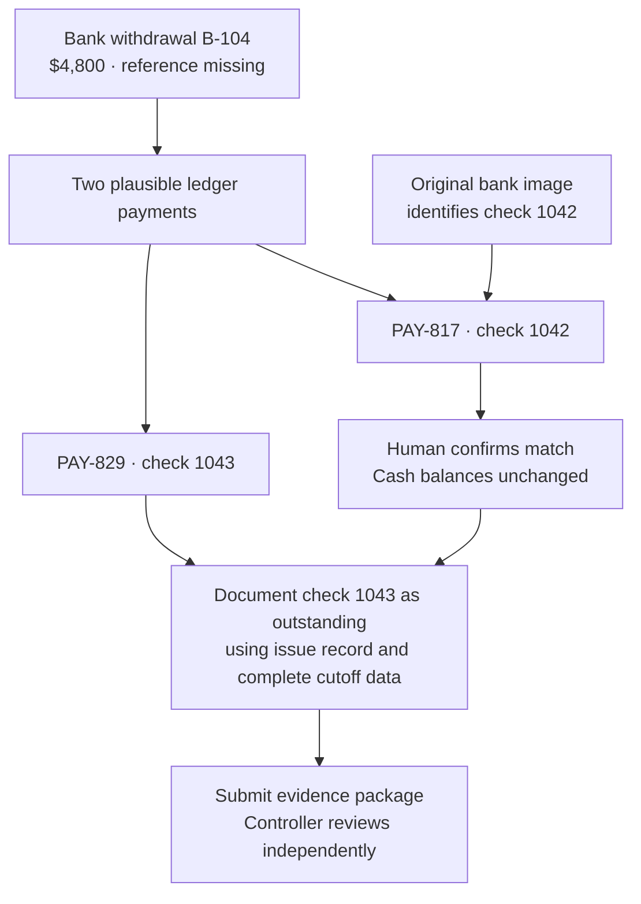
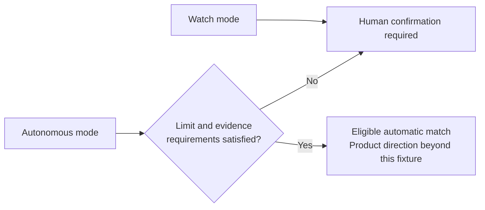
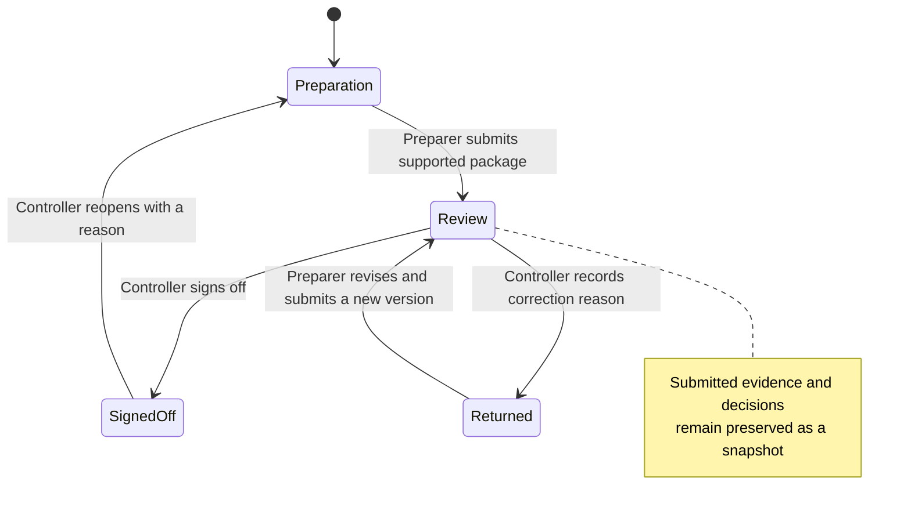

## What is this?

I designed and built a reconciliation prototype combining source evidence, agent permissions, and independent review. The business hypothesis: faster exception handling with decisions accountants can defend.

> **Status:** working prototype with synthetic records and simulated integrations. Primary user research and business outcomes remain unvalidated.

<aside class="case-glossary" aria-label="Finance glossary">
  
A quick finance glossary

  <dl>
    
<dt>Month-end close</dt><dd>Finishing and reviewing the month's accounting records.</dd>

    
<dt>Ledger / books</dt><dd>The company's accounting records.</dd>

    
<dt>Reconciliation</dt><dd>Explaining differences between bank activity and the books.</dd>

    
<dt>Outstanding check</dt><dd>A payment recorded in the books that has not cleared the bank by the cutoff.</dd>

    
<dt>Journal entry</dt><dd>An accounting entry that changes the books when posted; matching does not create one.</dd>

    
<dt>Invoice / purchase order (PO)</dt><dd>A supplier's payment request / the buyer's order; purchase context, not proof of bank clearance.</dd>

    
<dt>Controller / sign-off</dt><dd>The finance reviewer / their recorded approval of the prepared reconciliation.</dd>

  </dl>
</aside>

## Give accountants time back without hiding decisions

**Target user:** a Senior General Ledger Accountant at a lean US mid-market company, preparing USD cash reconciliations. A Controller owns policy and independently reviews. These roles await interview validation.

> **Job to support:** resolve uncertain payments and submit a defensible reconciliation without repeatedly assembling the same evidence across systems.

**The 2026 opportunity:** BlackLine announced agentic reconciliation preparation with human sign-off in July. KPMG reported 75% active finance AI use but 42% full assurance readiness. Its large-company sample provides context, not target-user validation. [BlackLine announcement](https://investors.blackline.com/news-releases/news-release-details/blackline-advances-governed-ai-finance-general-availability), [KPMG survey](https://kpmg.com/xx/en/media/press-releases/2026/05/ai-adoption-in-finance-doubles-but-assurance-readiness-determines-who-wins.html)

### The business case to test

| Illustrative inputs for one team | Assumed current workflow | Prototype target |
|---|---:|---:|
| Exceptions handled each month | 100 | 100 |
| Active handling time per exception | 8 minutes | 5 minutes |
| Monthly handling time | 13.3 hours | 8.3 hours |

**Modeled opportunity: 5 hours/month recovered, a 37.5% reduction in exception-handling time.** Formula: `100 × (8 − 5) ÷ 60`. At 50–200 exceptions, the same assumption yields 2.5–10 hours/month.

These are assumptions, not measured results or benchmarks. Recovered capacity is not cash savings; the model excludes implementation and operating costs and does not predict total close duration. Reviewer returns and unsupported decisions also need evaluation.

<figure>
  
  <figcaption>The workspace connects the next investigation to the account's overall readiness.</figcaption>
</figure>

## One withdrawal made the trust problem concrete

At September 30, two legitimate Harbor Supply payments are each **$4,800**. The bank feed lacks a reference. Choosing the nearest date could mark the wrong payment as cleared.

**The concept changed:** a dollar threshold alone cannot authorize a match. This payment is below the example $5,000 cap, yet its ambiguous reference still requires review.

| Agent mode | Permission contract |
|---|---|
| Assist | Investigate on request; a person confirms matches. |
| Watch | Investigate continuously; make no automatic record changes. |
| Autonomous | Record only policy-eligible matches; escalate evidence conflicts. |

<figure>
  
  <figcaption>The Controller owns policy. The cap limits match value, not acceptable variance. This flow posts no adjustments and contains no eligible unmatched item for autonomous execution.</figcaption>
</figure>

## Turn evidence into a reviewable decision

Secondary research informed a provisional persona, jobs-to-be-done, Trust Map, and state rules. I moved directly from task flow to code to test realistic decisions and recovery. The information architecture remains open to revision.

### 1. Explain the recommendation where the decision happens

<figure>
  
  <figcaption>Investigation showing both ledger candidates alongside the original cleared-check image, extracted fields, linked purchase records, and the explicit confirmation preview.</figcaption>
</figure>

- Compare both candidates beside the original image and extracted fields.
- Trace the choice through **B-104 → check 1042 → PAY-817 / GL-204 → invoice → PO**.
- Preview the exact relationship before saving; explain that cash balances stay unchanged.

I chose inspectable evidence over an unexplained confidence score. Invoices support the purchase; the bank image identifies clearance.

### 2. Explain why the agent stops

| Moment of doubt | Interface response | Intended business benefit |
|---|---|---|
| Has everything arrived? | Cutoff coverage and source versions; block incomplete preparation. | Avoid premature submission. |
| Why this payment? | Alternatives, original evidence, and specific matching fields. | Reduce repeated evidence gathering. |
| Did my action save? | Pending, failed, and uncertain results; check status before retrying. | Avoid duplicate actions and rework. |
| Can I correct it? | Unmatch with a reason; retain earlier actions and package versions. | Make review and recovery reconstructable. |

### 3. Separate a recorded match from a completed reconciliation

<figure>
  
  <figcaption>Outstanding-check investigation showing the existing payment, cutoff evidence, follow-up owner and date, and a timing treatment that creates no journal entry.</figcaption>
</figure>

Check 1043 already reduced the books. Outstanding treatment explains timing; recording another payment would duplicate it. [Accounting basis: OpenStax](https://openstax.org/books/principles-financial-accounting/pages/8-6-define-the-purpose-of-a-bank-reconciliation-and-prepare-a-bank-reconciliation-and-its-associated-journal-entries)

<figure>
  
  <figcaption>Controller's independent review package showing the balance bridge, linked decisions, preserved evidence snapshot, and sign-off or return actions.</figcaption>
</figure>

**$124,800 bank balance − $4,800 outstanding check = $120,000 book balance.** The unexplained difference becomes zero; the outstanding check and its follow-up remain visible.

### Build choices that made the controls testable

- **React + TypeScript + Vite:** synthetic evidence, browser-local persistence, and shared validation for permissions, evidence, and retries.
- **Visual system:** neutral surfaces, green emphasis, tabular numbers, Bklit charts, Phosphor icons, consistent responsive hierarchy, and reduced-motion support.
- **Orientation:** a skippable, replayable tour explains authority without revealing the answer.
- **Verification:** 15 unit and 10 browser checks pass. Automated checks establish neither usability nor full accessibility conformance.

AI findings, integrations, saves, and identities are simulated. There is no live model, production authentication, or shared backend. [Explore the source on GitHub](https://github.com/IrfanKurnia33/finodus-reconciliation/tree/main). Vercel deployment remains planned.

## Validate understanding before expanding autonomy

**What I learned through design and implementation**

- Permissions, evidence, saves, and review need separate states; one “done” indicator would conceal unfinished work.
- Watch makes investigation value testable before granting execution authority. Its usefulness remains unvalidated.
- Recovery belongs in the initial experience to expose misunderstanding of uncertainty and corrections.

**Future plan: first formative usability round**

| Plan | What I will observe |
|---|---|
| Recruit 4 preparing accountants and 2 Controllers; 45–60 minutes each. | Recent reconciliation experience and actual responsibilities. |
| Offer the optional tour; record uptake. | Orientation and mode comprehension. |
| Preparers resolve September's finding and prepare submission; do not name the correct check. | Evidence use, timing explanation, time, assistance, and confidence. |
| Controllers inspect a submitted package, then practice returning it. | Decision reconstruction, review boundaries, and actionable feedback. |
| Counterbalance missing-evidence / mistaken-match fixtures for preparers. | Recognition, recovery, and retained history. |

**Revision gates:** all 6 explain Watch's restriction; all 4 preparers identify the supported payment unaided; both Controllers explain the bridge and review status. Critical authority/accounting misconceptions trigger revision. Small-sample gates are not population success rates.

Then compare equivalent cases with current workflows, counterbalancing order. Include recovery and rework when measuring time, reviewer returns, and unsupported decisions. This tests the eight-to-five-minute hypothesis before expanding autonomous scenarios, integrations, and production controls.

> All screenshots show actual prototype states with synthetic data.*