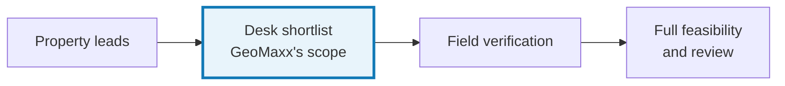
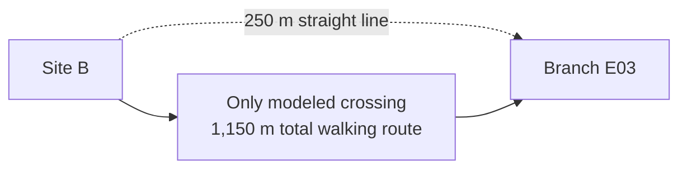
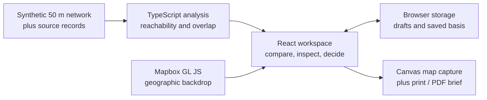
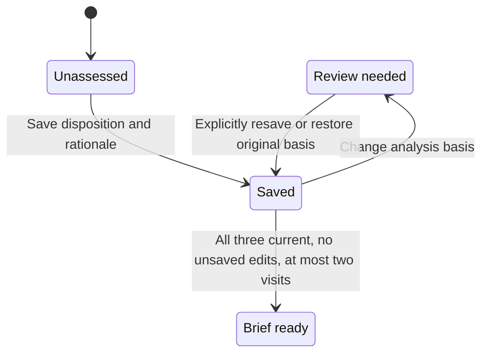

## Helping retail expansion managers spend field time on locations they can justify.

I researched, designed, and built a location intelligence prototype for shortlisting Jakarta minimarket properties. It brings access, existing-branch exposure, evidence gaps, and recommendations into one reviewable workflow.

<aside class="case-glossary" aria-label="GIS glossary">
  
A quick GIS glossary

  <dl>
    
<dt>GIS</dt><dd>Geographics Information Systems, software for examining information by location.</dd>

    
<dt>Catchment</dt><dd>The area reachable from a store under a chosen travel assumption.</dd>

    
<dt>Walking Network</dt><dd>Connected paths and crossings; distance follows those connections.</dd>

    
<dt>Overlap/Exposure</dt><dd>Shared catchment area; a reason to investigate branch impact.</dd>

    
<dt>Cannibalization</dt><dd>Customers shifting spending from an existing branch to a new one. Area overlap cannot measure that sales transfer.</dd>

    
<dt>Synthetic</dt><dd>Fictional records and geometry created for this demonstration.</dd>

  </dl>
</aside>

<figure>
  
  <figcaption>The geographic backdrop is real. Every candidate, branch, competitor, access link, and commercial record is fictional.</figcaption>
</figure>

## The shortlist has to survive questions

Before committing time to a site survey, an expansion manager needs to explain **why this property deserves a visit, which existing branches may be affected, and what remains unknown**.

Three informal practitioner conversations revealed consequential judgment behind that decision:

| Reported practice | What I designed for |
| --- | --- |
| P1/P2 described barriers, road sides, and actual access changing a site's appeal. | Compare connected walking coverage and retain physical-access checks. |
| Participants described different judgments about nearby strong branches; P1/P2 also considered capacity constraints. | Put branch conditions beside exposure, with room for a reasoned exception. |
| P1/P2 described reviewers challenging traffic observations and projection assumptions. | Keep source, observation period, and limitations with the recommendation. |

**The business opportunity:** reduce repeated preparation and make field visits more purposeful. P1 reported permits and negotiation as major delays, so I kept the product's efficiency hypothesis focused on desk work.

These conversations describe reported practices, not observed task performance. I used anonymized participant identifiers and paraphrases; the source notes include translation and editing.

## Show what could change the decision

I bounded the prototype to **three fictional properties, four existing branches, and up to two field visits**. Visit, hold, and reject are all valid; recommending no visits is also valid. The product leaves the judgment with the manager.

<figure>
  
  <figcaption>A common 500 m or 1 km walking-network assumption keeps comparison consistent. Neutral ordering avoids suggesting a predetermined winner.</figcaption>
</figure>

### Nearby on a map can mean a long walk

Site B sits **250 m from E03 in a straight line**, but the fictional crossing makes the walking route **1,150 m**. That changes how the manager should investigate shared coverage.

<figure>
  
  <figcaption>Walking coverage still leaves parking, frontage, deliveries, and the actual entrance to verify in the field.</figcaption>
</figure>

### Shared coverage needs business context

Site A combines substantial overlap with a report of queues and constrained space at E01. A visit could investigate that tradeoff; the capacity note cannot establish incremental sales.

  <figure>
    
    <figcaption>Site A inspector with E01 exposure, example performance, and capacity context expanded.</figcaption>
  </figure>
  <figure>
    
    <figcaption>Site C traffic record showing 180 passers-by during one payday-period evening, with source and limitation.</figcaption>
  </figure>
  <figure>
    
    <figcaption>Site C record explicitly showing unavailable E04 sales and trend and explaining that missing evidence is not zero risk.</figcaption>
  </figure>

> Site C's apparently attractive traffic count covers **one payday-period hour**. Its branch trend is unavailable. Both limitations become questions to resolve before relying on the site evidence.

**Two denominators, two questions:**

- Candidate coverage: shared area with the **union of existing catchments ÷ candidate area**. Shared cells count once.
- Branch exposure: shared area with a particular branch **÷ that branch's area**.

Neither percentage estimates customer switching or lost sales.

### Give reviewers the reasoning, too

<figure>
  
  <figcaption>Recommendation form containing a hold decision, rationale, open checks, and the saved analysis basis.</figcaption>
</figure>

The manager saves a disposition, rationale, and open checks. The printable brief carries the common assumption, branch context, sources, caveats, and remaining questions into review.

<figure>
  
  <figcaption>Completed decision brief with ready-for-review status, synthetic-study disclosure, and a captured map.</figcaption>
</figure>

<figure>
  
  <figcaption>The screenshot demonstrates one possible shortlist. These authored example decisions are not participant results or recommended real properties.</figcaption>
</figure>

> [Click here](https://files.irfankurnia.com/geomaxx/decision-brief.pdf) to see the actual printable brief document.

## Make the reasoning survive changes

I moved from the task and interaction map directly into coded prototyping, skipping separate wireframes. The map leads the desktop layout; collapsible panels reveal detail while preserving drafts. Mobile stacks the same working controls beneath the map.

- **Repeatable spatial logic:** breadth-first search on a bounded, four-way network; equal 50 × 50 m cells. The fine grid is a representation, not a claim about real-world data accuracy.
- **Explicit review:** changing distance recalculates coverage for every site and branch. Existing observations keep their original values; saved decisions retain their original basis.
- **Resilient workflow:** a synthetic network preview supports comparison when the map fails. Drafts persist in the same browser; there is no backend or team synchronization.

  <figure>
    
    <figcaption>Compare assumptions: Site B inspector comparing coverage and affected branches at 500 m and 1 km.</figcaption>
  </figure>
  <figure>
    
    <figcaption>Keep the task accessible on mobile: GeoMaxx comparison on a 390-pixel mobile viewport, with stacked candidate records and accessible inspection actions.</figcaption>
  </figure>

**Verification:** unit checks cover reachability, overlap denominators, duplicate counting, missing values, and brief readiness. Browser checks exercise recommendations, persistence, changed assumptions, printing, keyboard paths, and mobile layout. These verify implementation behavior; practitioner comprehension remains to be tested.

Satellite tiles returned HTTP 429 during case-study capture. The main map images use the available 3D style; the **availability screenshot** (*see below*) preserves the visible warning.

<figure>
  
</figure>

## Next step: put a number on the hypothesis, then test it

**Illustrative capacity model — assumptions, not achieved results or a measured baseline:**

<dl class="metric-grid" aria-label="Illustrative business projections">
  
<dt>Three-site comparison + brief</dt><dd>25%</dd><dd class="metric-context">120 minutes before → 90 minutes.</dd>

  
<dt>Reduction per batch</dt><dd>~30mins</dd><dd class="metric-context">or 25%</dd>

  
<dt>Monthly workload</dt><dd>20batches</dd><dd class="metric-context">(comparable)</dd>

  
<dt>Potential preparation capacity recovered</dt><dd>20 hrs/month</dd><dd class="metric-context">120 hrs/year</dd>

</dl>

Calculation: `(120 − 90) ÷ 60 × 20 = 10 hours/month`. The projection covers preparation only. Field travel, permits, negotiation, and store revenue are outside this estimate.

**What I would measure next:**

1. Observe target-role practitioners completing the three-site task, tracking assistance and critical misunderstandings.
2. Check whether reviewers can recover all three reasons, the common basis, and consequential caveats from the brief.
3. Compare preparation time against an equivalent existing-tool task using the same evidence; counterbalance task order before making a speed claim.

**What I learned:**

- Start with the decision and its handoff. An evidence-rich map becomes useful when someone can act on and explain it.
- Treat uncertainty as workflow content. Missing branch data and a narrow traffic sample should change the next question.
- Connect recommendations to assumptions. Preserving a rationale while flagging a changed basis makes revision explicit.