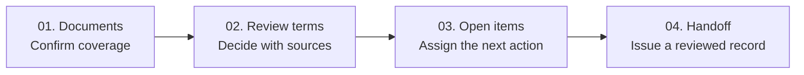
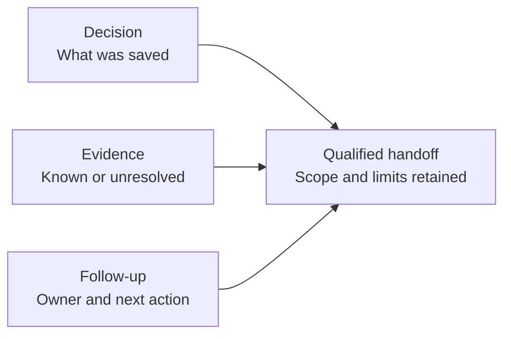

## A clearer route from amendment to action

A changed lease can affect next month's billing, a renewal deadline, and several colleagues' work. Stratis explores how a **US commercial property owner's lease team** can review those changes and pass on a dependable record.

<dl class="case-brief">
  
<dt>Business requirement</dt><dd>Keep the governing source, effective dates, unresolved evidence, and next owner together before information reaches Accounting.</dd>

  
<dt>My role</dt><dd>I led scope, practitioner research, workflow, interaction design, original branding, and prototype implementation with AI assistance.</dd>

  
<dt>Delivered</dt><dd>A working review-to-handoff prototype. Live extraction and integrations remain outside this slice.</dd>

</dl>

<aside class="case-glossary" aria-label="Real estate glossary">
  
A quick real estate glossary

  <dl>
    
<dt>Amendment</dt><dd>A document changing an existing lease.</dd>

    
<dt>Lease abstraction</dt><dd>Turning a contract into structured terms.</dd>

    
<dt>Renewal option</dt><dd>A right to extend a lease, subject to conditions.</dd>

    
<dt>Qualified handoff</dt><dd>A reviewed record with unresolved items still visible.</dd>

  </dl>
</aside>

<figure>
  
  <figcaption>The proposed value: a billing decision with its evidence attached. Screens show an authored fictional scenario, not participant work or production records.</figcaption>
</figure>

## Two practitioners, three design priorities

I narrowed a broad real estate AI concept to **amendment review and accountable handoff**. Extraction alone would leave the team to reconcile sources, interpret conditions, and chase missing information.

I ran two moderated browser sessions with practitioners at different US owner/operators: a senior reviewer and a junior preparer. They used a synthetic lease packet containing deliberately flawed suggestions.

| What the accounts revealed               | What I changed                                                           |
| ---------------------------------------- | ------------------------------------------------------------------------ |
| Both raised unclear status meanings.     | Separate a saved decision from verified evidence and finished follow-up. |
| Both raised interrupted source access.   | Keep relevant clauses beside the editor; use a drawer on narrow screens. |
| Both raised conditional-rights concerns. | Store known option terms separately from unverified eligibility.         |

<aside class="case-note">
<strong>Evidence boundary.</strong> These two accounts gave design direction. Missing timing, assistance logs, and final participant records prevent task-success or efficiency scoring. The revised design has not had another practitioner round.
</aside>

## Four destinations, one accountable record

The business requirement became four connected workspaces. Reviewers can save useful progress while missing evidence remains open.

- **Documents:** establish which lease and amendments belong together; flag missing references.
- **Review terms:** record the supported value, applicable period, and source.
- **Open items:** keep the question, owner, and required next action together.
- **Handoff:** check dependencies and acknowledge the record's qualified scope before export.

<figure>
  
  <figcaption>Coverage comes first: a source can be present while a referenced schedule is missing.</figcaption>
</figure>

## Three decisions that shaped the product

### 01 / Preserve the meaning of “done”

**Risk:** a completed review action could look like full approval. I separated decision, evidence, and work progress, then made release readiness depend on all three.

An unsupported expense cap stays unknown and needs an evidence request. An unsupported physical-condition assertion stays not assessed. Neither becomes a verified fact simply because someone finishes reviewing it.

### 02 / Keep the governing source in view

**Risk:** a valid base-lease citation could still support the wrong period after an amendment. Related provisions place amendment clauses beside the decision; reviewed input changes reopen dependent dates.

<figure>
  
  <figcaption>Intermediate widths retain editor/source adjacency. Below 900px, a source drawer preserves the decision context.</figcaption>
</figure>

### 03 / Retain a right without implying eligibility

**Risk:** “unknown” could erase useful option terms, while “confirmed” could imply conditions were satisfied. Structured fields preserve extension length, conditional rent, and dates alongside separate eligibility checks.

<figure>
  
  <figcaption>Known contract terms survive uncertainty about whether the tenant can exercise the option.</figcaption>
</figure>

The handoff then groups conditional rights, unknowns with next actions, and source-supported terms around the recipient's questions.

<figure>
  
  <figcaption>Accounting can see the effective period; the next reviewer can see what still needs evidence.</figcaption>
</figure>

## What I built and checked

- **Working interactions:** saved review progress, date selection, calculation invalidation, structured conditions, open-item ownership, and versioned HTML/JSON exports.
- **Visual system:** original branding, warm neutral surfaces, strong reading contrast, and distinct source typography. Semantic states pair color with text.
- **Implementation:** React, TypeScript, Vite, and browser-local persistence. Suggestions are prepared; AI-assisted development helped turn the workflow into an inspectable prototype.
- **Recorded checks:** seven model tests, a passing production build, the authored browser workflow, eight sampled widths from 320–1920px, and automated accessibility checks across 16 selected states.

<aside class="case-note">
<strong>What those checks establish:</strong> the prototype's rules and selected layouts work in the authored scenario. They do not establish user improvement, extraction accuracy, or accessibility conformance. Assignment is local; it does not notify a colleague or confirm acceptance.
</aside>

## The business case to test next

The opportunity is **less reconciliation and coordination effort without losing review quality**. The prototype makes that hypothesis testable; commercial value remains unmeasured.

<dl class="metric-grid" aria-label="Illustrative business projections">
  
<dt>Planning targetLess review effort</dt><dd>25%</dd><dd class="metric-context">40 → 30 minutes per amendment.</dd>

  
<dt>Illustrative projectionCapacity returned</dt><dd>~17h / mo</dd><dd class="metric-context">At 100 amendments per month.</dd>

</dl>

Illustrative assumptions, not observed results: (40 − 30) minutes × 100 amendments ÷ 60 ≈ 16.7 hours/month. This is potential capacity, not cash savings or a forecast.

Before making an ROI claim, I would compare equivalent unseen packets, capture independent versus assisted completion, inspect final records, and measure follow-up effort. Faster work only counts if source correctness and unresolved-item visibility hold up.

## What I'd carry forward

- **Model meaning before polishing status badges.** Separating decisions, evidence, and work gave the interface a coherent foundation.
- **Design the incomplete endpoint.** Useful reviewed information can coexist with missing evidence when scope and ownership stay explicit.
- **Capture outcomes during research.** Future sessions need final records, assistance notes, timings, and actual viewport dimensions.

The next round would include additional preparers, approvers, and an Accounting recipient. The key question: does a qualified handoff fit their policy and reduce remaining work? The extra structure has to earn the effort it asks of reviewers.

## Inspect the work

Explore the artifacts without adding a document viewer to the reading path:

- [Readable handoff](https://files.irfankurnia.com/stratis/example-qualified-handoff.html) · [PDF example](https://files.irfankurnia.com/stratis/example-qualified-handoff.pdf) · [Structured JSON](https://files.irfankurnia.com/stratis/example-qualified-handoff.json)
- [Fictional source packet](https://files.irfankurnia.com/stratis/s01-synthetic-source-packet.html) · [Authored evaluator key](https://files.irfankurnia.com/stratis/s01-expected-record-v1.json)
- [Feedback coding](https://docs.google.com/spreadsheets/d/1HIaKbvnA8oZ0y5VSmhTMRu5vUAQgZvEahvzjdmHYEOU/edit?usp=drive_link) · [Decision/evidence map](https://docs.google.com/spreadsheets/d/1ER3YrZqgyzy9bR_B2sSkrMQUyx7oZEjAr4Co_ODO17k/edit?usp=sharing)
- [Technical checks](https://files.irfankurnia.com/stratis/high-fidelity-technical-checks.json) · [Model tests](https://files.irfankurnia.com/stratis/model-tests.tap)
