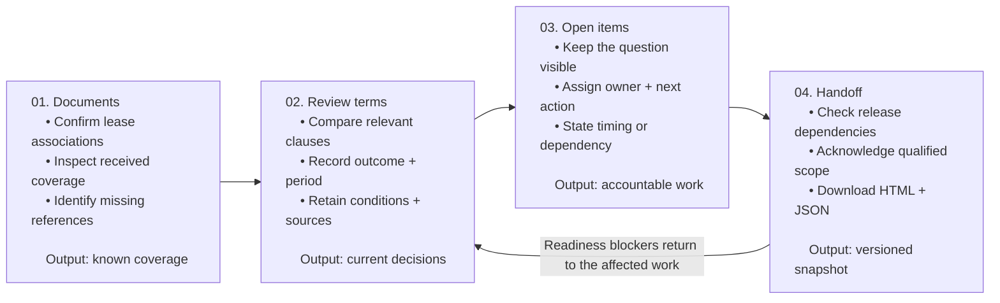
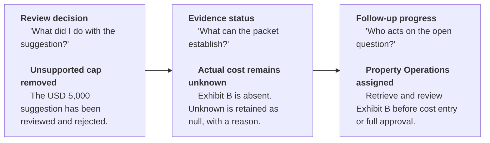

## At a glance

**Designing a commercial real estate workspace that preserves evidence, conditional rights, and the next action.**

A lease amendment can change what accounting should bill next month while leaving this month's rent untouched. An option can exist without being exercisable. A missing cost schedule can leave a value unknown even after a reviewer has finished checking the extraction.

I designed Stratis around these distinctions. The result is a working, high-fidelity prototype for reviewing one lease and amendment, recording supported terms, and handing unresolved questions to a colleague with their evidence and ownership intact.

> Two initial practitioner sessions informed the revisions. The revised prototype has technical verification; its effect on user performance and business outcomes remains unmeasured.

<figure>
  
  <figcaption>The recorded amount is USD 21,000; the original USD 19,500 draft remains visible for comparison. All current-prototype screenshots in this case study are author-prepared synthetic demonstrations, not participant work or production records. The sidebar uses a demonstration profile and stock portrait; the portrait does not depict a research participant.</figcaption>
</figure>

## Problem and scope

The original Stratis vision was broad: AI extraction of lease terms and obligations, property-risk signals, configurable taxonomies, portfolio monitoring, and specialist routing. I narrowed the first release concept to the point where an incoming document becomes operational information: **reviewing an amendment and preparing an accountable record.**

The central question became:

> How might a lease administrator establish the current terms and route unresolved questions while keeping the limits of the evidence visible?

### Why this mattered in 2026

Extraction already appears inside established property software. Yardi's April 2026 update describes extracting rent, options, and dates within Voyager. That challenged a positioning story built around extraction alone. [Yardi, Spring 2026 product update](https://www.yardi.com/blog/commercial-product-update-2026-q1/).

MRI's July 2026 guidance discusses provenance and human oversight in lease abstraction. JLL's August outlook describes continued difficulty tracking AI ROI. Together, these supported investigating traceable review and useful downstream output. They did not establish an unmet market need for Stratis. [MRI, AI governance in lease abstraction](https://www.mrisoftware.com/blog/everyones-using-ai-for-lease-abstraction-almost-nobody-is-ready-for-an-audit/), [JLL, 2026 mid-year outlook](https://www.jll.com/en-us/insights/market-outlook/global-real-estate).

> **My strategic inference:** a separate product would need to justify the review and coordination effort it adds alongside existing systems. I chose to explore exception handling and handoff as a differentiation hypothesis. No competitive superiority, adoption intent, or willingness to pay has been demonstrated.

### The first boundary

I kept source review, effective periods, critical dates, conditional terms, missing evidence, and follow-up in scope. Portfolio dashboards, taxonomy builders, broad hazard assessment, and live integrations remained outside this slice.

***This made a meaningful failure state possible to design:*** the reviewer can complete useful work while the record remains incomplete. The interface needs to explain that state without pressuring the reviewer to invent a value or imply approval.

## Role-based personas

I began with a provisional lease administrator persona. Screening then exposed two responsibility patterns within the same team.

| | P01: senior reviewer | P02: preparer |
| --- | --- | --- |
| Context, self-reported | Regional US owner/operator; office and industrial/flex. | National US owner/operator; retail and neighborhood shopping centers. |
| Work owned | Document-chain verification, complex abstraction, coordination, and final approval. | Collection, initial abstraction, draft entry, follow-up, and escalation. |
| Tools reported | Yardi Voyager, SharePoint, Acrobat Pro, Excel. | MRI, Box, Excel, internal workflow tools. |
| Recent example | Several amendments created expense-calculation ambiguity requiring Legal and Accounting coordination. | A missing exhibit and delivery-dependent abatement date kept an entry in Draft pending senior verification. |

These accounts provisionally supported the lease administration **team** as the target. They also challenged a single persona with uniform approval authority. I kept preparation, senior review, and downstream use distinct. The prototype's role selector records follow-up ownership; it does not implement organizational permissions.

The primary job-to-be-done is an authored synthesis, rather than a participant quotation:

> When a new lease or amendment enters our portfolio, I need to establish the current obligations, verify their sources, and route unresolved items to the right owner, so our records and follow-up actions are dependable.

Supporting jobs are to:

- Establish document coverage
- Reconcile terms across documents
- Retain uncertainty
- Assign the next action
- Publish a record whose meaning survives export.

Property Operations, Legal, and Accounting are supporting roles. The buyer and budget holder remain unknown.

## The main task

### A synthetic task with a deliberately incomplete endpoint

> At the start, I had neither participant access nor a redacted lease set. I built a controlled scenario from public practices and document patterns, then used it when two practitioners became available. No real lease corpus was supplied.

A historical SEC-hosted amendment illustrates changing rent periods, conditional renewal provisions, and retained terms. GSA's file-management guidance illustrates maintaining related lease documents and assigned document responsibility. These informed the scenario's structure; the SEC filing is one example, and federal tenant-side guidance does not govern private owner/operators. [SEC-hosted Fifth Amendment, 28 April 2017](https://www.sec.gov/Archives/edgar/data/926326/000162828017005045/exhibit103fifthamendmentto.htm), [GSA Leasing Desk Guide, Chapter 17, section 4(a)](https://www.gsa.gov/system/files/Real_Estate_Acquisitions/LDG-Chapter%2017-LeaseAdministration_11_22_19.pdf).

**S01** places the reviewer at fictional Westbridge Center on a fixed review date, **21 October 2026**. The packet contains a base lease, its first amendment, and 13 authored extraction suggestions. Six faulty suggestions form five issue groups; seven other suggestions act as controls. This selected mixture is an evaluation fixture, not an AI error rate.

| Issue built into the draft | Expected representation in the authored evaluation key |
| --- | --- |
| E1: stale future rent | USD 19,500/month remains current through 31 October 2026. USD 21,000/month applies from 1 November 2026 through 31 August 2027. |
| E2: old notice interval and derived date | Replace 180 with 270 calendar days. Derive receipt by 4 December 2026, 5 p.m. America/Chicago, retaining the courier and receipt requirements. |
| E3: unconditional eligibility | Record the option and known terms while leaving satisfaction of its conditions unverified. |
| E4: invented expense cap | Remove the unsupported USD 5,000 cap. Actual cost terms remain unknown because Exhibit B is absent; request the executed schedule. |
| E5: unsupported mold assertion | Reject the physical-condition claim. Retain the reporting duty without declaring either presence or absence of mold. |

The last issue tested an important product boundary: a lease obligation is not physical-condition evidence. EPA's commercial-building guidance discusses inspections and moisture prevention, providing additional context for keeping condition assessment distinct from contractual language. The prototype performs neither inspection nor diagnosis. [EPA, commercial-building mold guidance](https://www.epa.gov/mold/mold-remediation-schools-and-commercial-buildings-guide-chapter-2).

The exercise cannot reach full abstract approval because the missing schedule and condition-status evidence never arrive. Its proposed endpoint is a **qualified review package**: reviewed information with explicit limits and actionable open work. Whether a real organization permits that form of partial handoff remains an open policy question.

The [source packet](https://files.irfankurnia.com/stratis/s01-synthetic-source-packet.html), [starting suggestions](https://files.irfankurnia.com/stratis/s01-authored-draft-v1.json), and [evaluator key](https://files.irfankurnia.com/stratis/s01-expected-record-v1.json) are attached separately. The evaluator key is excluded from app data and does not choose the reviewer's answers. These case-study attachments disclose the exercise and should not be given to future participants before testing.

## The review workflow

### Turning the job into a review workflow

I mapped six work stages—confirm context, establish coverage, review evidence, assign open work, check the record, and choose the handoff—into four lease-level destinations. The stages describe work; they do not require six screens or a rigid sequence.

#### From received amendment to accountable handoff
##### Authored S01 workflow · Work can be saved before release · Full approval remains unavailable

> **A qualified handoff preserves unresolved evidence.**   
> Local assignment ≠ recipient acceptance. Download ≠ full approval. New reviewed inputs reopen dependent dates.

| Destination | Question it should answer |
| --- | --- |
| 01. Documents | Do these files belong to this lease, and what referenced material is missing? |
| 02. Review terms | What does the relevant source establish for this term and period? |
| 03. Open items | What evidence or decision is needed, who owns it, and when should it happen? |
| 04. Handoff | What will the recipient receive, and what remains unresolved? |

The first connected wireframe used a term queue, decision editor, source reader, follow-up dialog, and JSON handoff preview. That made the state model concrete enough for feedback.

It also exposed weaknesses that a static screen could conceal: independent action/evidence controls could disagree, review counts could imply readiness, and narrower layouts made evidence and the decision mutually exclusive.

<figure>
  
  <figcaption>The available pre-revision wireframe shows separate review-decision and evidence-status controls and a generic source selector.</figcaption>
</figure>

*Available pre-revision build, preserved as design history. This is an authored technical capture; the exact build identifier used in the participant sessions was not recorded.*

## First user testing

### Method and evidence quality

I recruited and moderated two browser sessions on two separate days, using five broad prompts about navigation, source access, status meaning, complex terms, and recipient handoff. Both participants reported recent commercial amendment work at different US owner/operators. Both used only the browser and had no source-code or answer-key access.

The protocol drew on neutral-task and moderated-testing guidance. It aimed to examine whether a reviewer could prepare a usable record, rather than follow prescribed clicks. [NN/g, qualitative usability task guidance](https://www.nngroup.com/articles/better-usability-tasks/), [GOV.UK, moderated usability testing](https://www.gov.uk/service-manual/user-research/using-moderated-usability-testing).

The available record consists of screening answers and final session notes. P01's statements are labeled verbatim in those notes; P02's account is explicitly recorded as the researcher's observations. Technical identifiers and code references are treated as annotations or analysis, given the confirmed browser-only access.

Exact window dimensions, session duration, assistance logs, and final saved/exported participant records were not captured in the supplied artifacts. As a result, I could synthesize feedback but could not score task completion, issue handling, errors, or time. The originally planned rubric was broader than the evidence actually collected.

### Quantifying the feedback without inventing a score

I coded each of the five prompt-level accounts as Positive, Mixed, or Negative. Positive meant favorable without a material concern recorded; Mixed combined useful aspects with meaningful friction; Negative recorded an explicit inability or negative assessment. This was a single-analyst interpretation, with no independent second coding.

| Prompt | P01 account | P02 account |
| --- | --- | --- |
| Q1: destinations and next task | Mixed | Positive |
| Q2: source and decision arrangement | Mixed | Mixed |
| Q3: handled, verified, and assigned | Negative | Mixed |
| Q4: complex terms and form effort | Mixed | Mixed |
| Q5: recipient handoff meaning | Mixed | Positive |

Across **10 coded assessments from the same two accounts: 2 Positive, 7 Mixed, 1 Negative**. These are repeated qualitative observations, not ten participants, a 20% usability score, or a task-success rate. The [coding table](https://docs.google.com/spreadsheets/d/1HIaKbvnA8oZ0y5VSmhTMRu5vUAQgZvEahvzjdmHYEOU/edit?usp=drive_link) preserves the denominator and account types.

### Findings that changed the design

| Finding | Evidence in the accounts | Design consequence |
| --- | --- | --- |
| Understandable labels did not guarantee clear next work. | Both accounts could explain the four destinations. P01 criticized next-task guidance; the P02 account described it favorably. | Retain the labels provisionally; add contextual next actions and save-and-next-unreviewed. |
| Evidence access lost continuity on narrower layouts. | Present in 2 of 2 accounts. Actual session widths were not recorded. | Preserve an adjacent reference surface at useful widths and an accessible narrow drawer. |
| Status distinctions were difficult to understand or scan. | Present in 2 of 2 accounts; P01 explicitly rejected the existing distinction in Q3. | Separate the meanings in the model and derive coherent review outcomes and readiness. |
| Conditional rights lacked structure. | Present in 2 of 2 accounts. | Preserve known option terms separately from each condition and its checkpoint. |
| Amendment effects were hard to discover. | Explicit in P01's account; a separate audit confirmed all starting citations pointed to the base lease. | Surface titled related amendment provisions beside the decision. |
| Handoff legibility and effort needed attention. | P01 described repetitive entry and difficult recipient scanning. P02's account favored the qualified preview. | Keep qualification; bring evidence state, period, owner, and action together and offer a readable export. |

I preserved the disagreements. Seniority, asset type, organization, and individual expectations varied together; two accounts cannot explain which difference caused the divergent assessments. A concern in one account could still deserve priority because of its potential consequence.

## Post-test audit

The session feedback led me to inspect the implementation. These are independently reproduced technical findings, not additional participant errors:

| Defect in the available pre-revision build | Why it mattered | Revision |
| --- | --- | --- |
| Thirteen saved decisions could produce “Reviewed with open items” despite unconfirmed association or no actionable open work. | A count implied a record state it had not established. | Derive readiness from association, current decisions, references, dependencies, and required follow-up. |
| Independent action/evidence selectors allowed contradictory combinations. | “Confirmed” could coexist with an unknown value. | Derive both from one coherent review outcome. |
| Required cost information marked “Not assessed” could bypass follow-up. | A status choice concealed a required evidence gap. | Make requiredness and assessment scope part of readiness. |
| An unsaved date draft could retain an old interval. | A reviewer could work with stale calculation inputs. | Invalidate saved results and unsaved drafts when reviewed dependencies change. |

I addressed these consistency issues before visual refinement. The broader design priorities were then structured conditional rights, discoverable evidence, and a readable handoff. I proceeded without a second participant round because the participants were busy, retaining the open assumptions rather than treating implementation as validation.

## 3 main revisions

### A. Coherent outcomes and structured conditional rights

The revised editor offers one review outcome. Underlying decision and evidence meanings remain distinct, but the form prevents combinations that contradict one another.

| Outcome | Meaning retained |
| --- | --- |
| Supported as drafted | Keep the original value and reviewed support; the value is read-only under this choice. |
| Supported, corrected | Record the corrected value, a reason, and evidence. |
| Conditional right — status unverified | Keep established option terms and separate unverified conditions. |
| Not supported — evidence needed | Retain an explicit unknown and the evidence request. |
| Not assessed | Reject the proposed assertion without asserting its opposite. Required information can still need follow-up. |

#### A finished decision can leave an unanswered question
##### Design model · Example: an unsupported expense cap and a missing cost schedule

The three separate meanings of review decision, evidence status, and follow-up progress, illustrated with the missing expense schedule.

> **All three states travel together in the qualified handoff.**   
> Recording a decision or assigning a request cannot establish the missing evidence.

For the renewal option, a generic value-or-null model was insufficient. The revised record retains a 36-month extension, USD 22,000 monthly rent if exercised, and the conditional September 2027–August 2030 period.

It separately records no-default checks at notice receipt and extension commencement, plus compliant notice receipt. Each satisfaction status remains **Not verified**.

<figure>
  
  <figcaption>Known terms survive uncertainty about eligibility. The conditional period is derived from the authored term and extension length; it is not evidence that the option has been exercised.</figcaption>
</figure>

This adds form structure. To contain the burden, I combined outcome selection, added inline follow-up, retained existing assignment progress, and introduced Save & next unreviewed. I did not preselect an accountable owner. Whether the added structure earns its effort remains open.

The extended option fields and current-rent end date were versioned in an [evaluation addendum](https://files.irfankurnia.com/stratis/s01-v02-evaluation-addendum.html). I did not retrospectively count their absence as participant failures or alter the original seeded-error denominator.

### B. Discoverable amendments and continuous source access

A technically valid citation can point to language that no longer governs the recorded period. I replaced the generic discovery burden with titled **Related provisions** beside the decision, placing amendment provisions first and allowing contextual source retention. Full-document browsing remains available.

These relationships are authored links between supplied clauses. They demonstrate evidence presentation; they do not implement AI retrieval, automatic conflict resolution, or verification.

At 1600 pixels and above, the queue, editor, and source share three columns. At 900–1599, the queue moves above the adjacent editor and source. Below 900, a nonmodal bottom drawer keeps the decision in place while the reference is open. The source reader remains sticky on desktop.

<figure>
  
  <figcaption>A technical layout demonstration at 1024 pixels, not a recorded participant viewport.</figcaption>
</figure>

The trade-off is deliberate: the desktop queue uses more vertical space at intermediate widths, while the narrow drawer occupies part of the editor's viewport. The decision remains available, but whether this arrangement improves comprehension needs observation at actual working widths.

For the notice milestone, source access works with a dependency rule. The reviewed term end minus the reviewed 270-day interval yields 4 December 2026 under this fixture's counting convention. Receipt time, zone, and delivery rule stay separate from the date. Editing either reviewed input reopens the dependent result, including unsaved drafts.

Arithmetic consistency cannot establish the legal correctness of an interpretation. A reviewer can still approve an incorrect interval if they misread the source; the prototype does not consult the evaluator key to prevent that.

### C. A handoff organized around the recipient's questions

The earlier handoff followed lease order and separated terms from their owners. Its downloadable output was JSON. I made a readable summary the primary deliverable and grouped the preview by evidence meaning: conditional rights, unknowns with next actions, source-supported terms, and matters not assessed.

<figure>
  
  <figcaption>The missing cap stays unknown. Its evidence request, Property Operations owner, and dependency remain attached to the term. October and November rent retain distinct periods.</figcaption>
</figure>

The same record can show 13 decisions saved, two open items, and readiness for a qualified handoff. That does not make it fully approved. Readiness requires current decisions and calculations, source references, actionable required follow-up, saved or discarded drafts, and explicit acknowledgement of the release scope.

The physical-condition claim is treated differently from required cost information: it remains Not assessed without creating a remediation task from an unsupported assertion. Required cost uncertainty still needs follow-up. This avoids treating every unknown as the same kind of work.

Standalone HTML and structured JSON share an issued revision. Later saved changes supersede the snapshot; existing downloads cannot be recalled. A local assignment does not send a message or establish that a recipient accepted the work.

Inspect the authored [readable handoff](https://files.irfankurnia.com/stratis/example-qualified-handoff.html), [PDF rendering](https://files.irfankurnia.com/stratis/example-qualified-handoff.pdf), or [matching JSON](https://files.irfankurnia.com/stratis/example-qualified-handoff.json). These demonstrate the delivered representation, not recipient comprehension.

## Hi-Fi Prototype

I designed the original logomark and logotype and set a warm, restrained brand direction. Most surfaces stay neutral; brown anchors identity and primary actions, with copper, gold, and peach accents for context. Semantic states pair color with text.

| Visual choice | Purpose |
| --- | --- |
| TikTok Sans headings | Establish the property, workspace, and term hierarchy. |
| Plus Jakarta Sans body | Keep controls and explanations consistent. |
| Merriweather source text | Distinguish contractual language from the application's interpretation. |
| Roboto Mono quantities and references | Give dates, money, counts, and source identifiers a consistent numeric treatment. |
| Solar icons, shadcn/ui components, selective beUI motion | Support a coherent interface with focus behavior, restrained feedback, and reduced-motion support. |

After reviewing the high-fidelity build on a 1920×1080 monitor, I requested larger type, stronger weights, clearer page/card contrast, and calendar-based date selection.

Those refinements are product-owner design review, separate from the practitioner sessions. The current scale uses 18px body text, 16px controls and source text, medium reading weights, and stronger headings. Smaller screens reorganize content rather than shrinking the reading scale.

<figure>
  
  <figcaption>Original brand artwork, warm neutral canvas, white cards, and explicit document context.</figcaption>
</figure>

Fonts, icons, logos, and the stock profile portrait are hosted locally. This slice works without external asset requests or API keys. The implementation uses React, TypeScript, Vite, and browser-local persistence; there is no live AI extraction behind the prepared suggestions.

## Prototype results

### What the working prototype establishes

The delivered artifact makes the review rules inspectable through working interactions, including persistence, revision handling, source retention, date selection, calculation invalidation, and downloadable output.

| Evidence | Recorded result | Practical limit |
| --- | --- | --- |
| Model regression tests | Seven tests pass, covering outcome coherence, periods/receipt context, dependency invalidation, required follow-up, conditional rights, readiness, and export/revision behavior. | These assess implementation rules, not users' interpretation of lease language. |
| Production build | TypeScript and Vite build pass. | Buildability does not establish production readiness. |
| Browser workflow QA | Full authored synthetic flow, downloads, persistence/reset, local assets, keyboard behavior, and revision supersession pass. No runtime errors recorded. | Prepared decisions are not participant outcomes. |
| Responsive checks | Eight selected widths: 320, 390, 900, 1024, 1200, 1280, 1440, and 1920 CSS pixels. Source/editor adjacency checked at six desktop widths. | These are sampled layout checks, not evidence of participant efficiency or every device configuration. |
| Automated accessibility checks | No violations reported in 16 selected screen/dialog states using selected WCAG A/AA rules. | This is not a conformance audit or a substitute for assistive-technology research. |

The [technical report](https://files.irfankurnia.com/stratis/high-fidelity-technical-checks.json), [model-test output](https://files.irfankurnia.com/stratis/model-tests.tap), and [capture record](https://files.irfankurnia.com/stratis/capture-record.json) keep those claims separate from the user study.

<figure>
  
  <figcaption>The 44-day interval is measured from the fixed scenario review date, not from the reader's current date. Readiness applies to a qualified package only.</figcaption>
</figure>

There is no live ingestion, extraction model, authentication, production permission model, external routing, billing change, notice delivery, recipient acceptance, or task-closure flow. Returned-document processing remains future scope; local reviewed-input changes and snapshot supersession work now. GitHub/Vercel deployment is prepared, not completed.

## Lessons learned

**The most useful design work was in the meaning of the record.** Visual hierarchy mattered, but a clearer badge alone could not fix a model that collapsed a known right and unknown eligibility into one value. Defining evidence, decision, work, and release separately gave the interface a coherent basis.

**A citation needs context.** The starting draft could cite a real base-lease clause and still be wrong for the future period. Document relationships and effective dates became first-class review information, rather than details available only after opening a source.

**An unresolved endpoint can be a legitimate design outcome.** The scenario became more informative because it could not end in full approval. It required the product to preserve what was known while explaining exactly what another person needed to do.

**My research capture was too limited for outcome scoring.** The five prompts produced useful direction, but missing final records, assistance notes, and timing prevented assessment against the planned task rubric. In a future round, I would record those artifacts and actual window dimensions alongside the qualitative notes. I would also keep direct participant statements and moderator interpretation in separate fields from the start.

The result is a research-informed, technically checked concept. Two accounts do not establish saturation, revised usability, extraction accuracy, time savings, or commercial value. The project moved forward without another round; that decision did not close the assumption register.

## Next steps

No additional session is scheduled or required to complete this portfolio phase. If the concept advances, I would recruit additional preparers and approvers across more than one owner/operator, plus an Accounting/Billing recipient and appropriate legal/domain reviewers. An initial 4–6 practitioner sample would be a formative planning choice, not a statistically representative study.

| Open hypothesis | Question or task | Evidence to collect or challenge |
| --- | --- | --- |
| A06: qualified field-level handoff fits policy. | “What could leave Draft while this schedule is missing? Who permits that?” Ask the recipient what they would use. | Actual allowed-use rules; correct recognition of withheld or conditional information. An all-or-nothing policy would challenge the proposed endpoint. |
| A13: the revised status model is understandable. | “What has been checked here? What is still unanswered? What does this assignment establish?” | Explanations and resulting actions distinguishing saved review, evidence, and work progress. |
| A15: structured rights match real checkpoints. | “How do you record an option whose conditions must be checked later? What triggers another check?” | Whether known terms survive, unverified eligibility remains clear, and checkpoints fit actual approval policy. |
| A17: source continuity supports real review. | Give an equivalent unseen amendment at the participant's actual working width. Ask them to prepare the record without prescribing navigation. | Captured dimensions, assistance, source interpretation, final saved record, and observed switching/scrolling. |
| A18: accountability earns its review effort. | “Which parts repeat work you already do? What would remain after this output?” | Entry burden and remaining work, interpreted alongside correctness rather than click count alone. |
| A08/A09: Stratis adds operational value. | Walk through a recent amendment and identify unresolved work in current tools. | Baseline effort, waiting dependencies, downstream rework, integration requirements, and buyer priorities. |

Future task scoring would distinguish independent, assisted, incomplete, and incorrect completion. It would assess recognition and correct handling of each issue, preservation of controls, unsupported approvals, and handoff completeness from final records. Time would be reported only with correctness and assistance. Comparative claims would require equivalent unseen packets and appropriate allocation; repeating S01 after learning its answers would confound a time-saving claim.

Real extraction evaluation would be a separate effort using a permitted, representative document corpus and expert-reviewed references. It cannot be inferred from a deliberately seeded interface exercise. Broader risk taxonomy and portfolio features would need their own user, evidence, and ownership research.

## Supporting materials

Everything needed to read the case and inspect its examples is contained in this folder. Raw participant records remain in the internal project history; this package uses participant IDs and derived summaries.

| Attachment | What it provides |
| --- | --- |
| [Source packet](https://files.irfankurnia.com/stratis/s01-synthetic-source-packet.html) | Self-contained reviewer brief, base lease, and amendment; all fictional. |
| [Starting draft](https://files.irfankurnia.com/stratis/s01-authored-draft-v1.json) · [Evaluator key](https://files.irfankurnia.com/stratis/s01-expected-record-v1.json) · [Coverage addendum](https://files.irfankurnia.com/stratis/s01-v02-evaluation-addendum.html) | Separately labeled authored inputs and criteria; not participant results. |
| [Feedback coding](https://docs.google.com/spreadsheets/d/1HIaKbvnA8oZ0y5VSmhTMRu5vUAQgZvEahvzjdmHYEOU/edit?usp=drive_link) · [Decision/evidence map](https://docs.google.com/spreadsheets/d/1ER3YrZqgyzy9bR_B2sSkrMQUyx7oZEjAr4Co_ODO17k/edit?usp=sharing) | Ten prompt-level assessments and traceability from findings to design decisions. |
| [Open assumptions](https://docs.google.com/spreadsheets/d/1KNTiueV6bLbcHvqp-5-EVSV9zckt_cmhNQEIruJknAw/edit?usp=sharing) | All 18 assumptions with current basis, status, risk, and future evidence. |
| [Workflow diagram](#the-review-workflow) · [State model diagram](#3-main-revisions) | Accessible, scalable authored design explanations. |
| [Original review view](../../projects/stratis/11-pre-revision-review.png) · [Original handoff](../../projects/stratis/12-pre-revision-handoff.png) | Preserved pre-revision design history; not participant captures. |
| [Condition checkpoint detail](../../projects/stratis/05-condition-checkpoints.png) · [Open items](../../projects/stratis/06-open-items.png) | Additional current-prototype examples. |
| [HTML handoff](https://files.irfankurnia.com/stratis/example-qualified-handoff.html) · [PDF](https://files.irfankurnia.com/stratis/example-qualified-handoff.pdf) · [JSON](https://files.irfankurnia.com/stratis/example-qualified-handoff.json) | One authored issued revision, rendered for people and structured reuse. |
| [Technical checks](https://files.irfankurnia.com/stratis/high-fidelity-technical-checks.json) · [Model tests](https://files.irfankurnia.com/stratis/model-tests.tap) · [Capture record](https://files.irfankurnia.com/stratis/capture-record.json) · [Source provenance](attachments/source-provenance.json) | Verification boundaries, screenshot dimensions, and source-record hashes. |