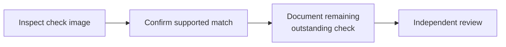

<aside class="case-glossary" aria-label="Finance decoded">
  
Finance, decoded

  <dl>
    
<dt>Ledger / books</dt><dd>Company accounting records.</dd>

    
<dt>Reconciliation</dt><dd>Explain bank/book differences.</dd>

    
<dt>Outstanding check</dt><dd>Recorded payment awaiting bank clearance.</dd>

    
<dt>Sign-off</dt><dd>Independent review approval.</dd>

  </dl>
</aside>

## The problem

> Two legitimate $4,800 payments; one bank withdrawal without a reference. Guessing could mark the wrong payment as cleared.

<figure>
  
  <figcaption>Working investigation: two payment candidates beside the original bank image identifying check 1042.</figcaption>
</figure>

> **The solution:** put evidence and authority beside the decision. Watch investigates without automatic changes. Dollar limits never override evidence conflicts.

<figure>
  
  <figcaption>Actual balance bridge: USD 124,800 bank balance less the USD 4,800 outstanding check equals USD 120,000 in the books, with no book adjustment.</figcaption>
</figure>

## Projected opportunity

**5 hours/month recovered per team.** Illustrative assumptions: 100 exceptions × (8 − 5 minutes) ÷ 60. A **37.5% handling-time reduction**, unmeasured; capacity, not cash savings.

**Learning** Matching, timing, and sign-off need separate states. Recovery needs the same care as success.

**Built:** React/TypeScript, browser-local state, enforced decision gates, and a replayable product tour.

## Next Steps

1. Six formative sessions—four accountants
2. Two Controllers—to test Watch comprehension
3. Evidence selection, timing, review, and recovery
4. Benchmark equivalent tasks against current workflows.