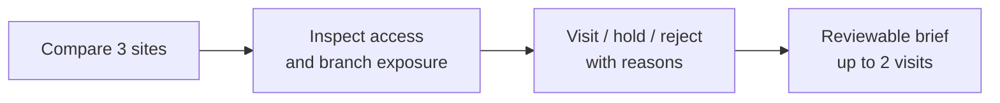

## Overview

**A location intelligence prototype for Jakarta minimarket expansion.**

<aside class="case-glossary" aria-label="GIS glossary">
  
A quick GIS glossary

  <dl>
    
<dt>GIS</dt><dd>Geographics Information Systems, software for examining information by location.</dd>

    
<dt>Catchment</dt><dd>The area reachable from a store under a chosen travel assumption.</dd>

    
<dt>Walking Network</dt><dd>Connected paths and crossings; distance follows those connections.</dd>

    
<dt>Overlap/Exposure</dt><dd>Shared catchment area; a reason to investigate branch impact.</dd>

    
<dt>Cannibalization</dt><dd>Customers shifting spending from an existing branch to a new one. Area overlap cannot measure that sales transfer.</dd>

    
<dt>Synthetic</dt><dd>Fictional records and geometry created for this demonstration.</dd>

  </dl>
</aside>

<figure>
  
  <figcaption>GeoMaxx workspace with a Jakarta basemap, fictional properties, and candidate evidence.</figcaption>
</figure>

## Initial research

Three practitioner conversations informed a workflow for comparing sites, questioning evidence, and preserving the rationale.

<figure>
  
</figure>

> **Access changes the question:** Site B is 250 m from E03 directly; the fictional walking route is 1,150 m.

<figure>
  
  <figcaption>Site B's catchment, modeled barrier, and access explanation.</figcaption>
</figure>

  <figure>
    
    <figcaption>Question the evidence: Site C's single payday-period observation and its limitation.</figcaption>
  </figure>
  <figure>
    
    <figcaption>Carry reasons into review: Saved hold recommendation with rationale and open checks.</figcaption>
  </figure>

## Closing

**Potential impact:** assuming 120 → 90 minutes per three-site batch and 20 batches/month, **10 preparation hours/month** recovered. This is an illustrative projection, not a measured result.

**Delivered:** working prototype and printable brief. All study records are fictional; overlap cannot estimate lost sales. Practitioner usability testing is next.

**Learning:** make assumptions and missing evidence part of the decision.